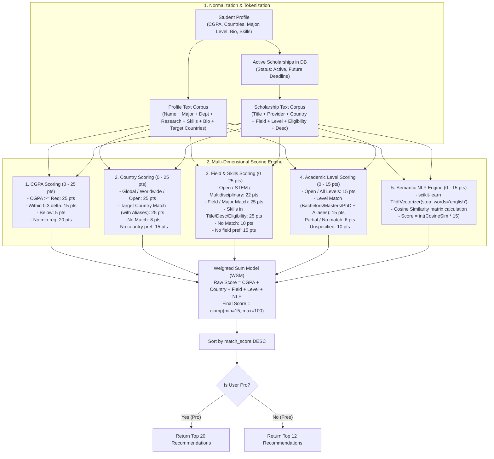

# Smart Matchmaker — Complete Technical Architecture & Workflow

> **ScholarshipConnectBD Intelligent Recommendation Engine**  
> A Hybrid Content-Based Recommendation System combining **Deterministic Rule Constraints**, **Vector Space TF-IDF**, **Cosine Similarity NLP**, and **Weighted Sum Scoring (WSM)**.

---

## 1. Overview & Core Philosophy

Finding suitable scholarships usually involves manual searches through thousands of websites where criteria like CGPA, level of study, field of specialization, and nationality are scattered.

The **ScholarshipConnectBD Smart Matchmaker** solves this by:
1. **Hard Filtering & Strict Rule Satisfaction**: Filtering out opportunities where the student does not qualify (or grading near threshold).
2. **Multi-Faceted Structured Scoring**: Quantifying alignment across **CGPA**, **Target Countries**, **Field of Study / Major**, and **Academic Level**.
3. **Semantic NLP Matching (TF-IDF + Cosine Similarity)**: Comparing unstructured student data (bio, research interests, skills, achievements) against scholarship descriptions and eligibility clauses.
4. **Weighted Score Blending**: Producing a deterministic, explainable `match_score` from **0% to 100%**.
5. **Tier Optimization**: Displaying **Top 12** matches for standard members and **Top 20** matches for **ScholarConnect Pro** subscribers.

---

## 2. Matchmaker Workflow (Flowchart & Architecture)



---

## 3. Detailed Scoring Breakdown (Point-by-Point)

Total maximum raw score achievable is **100 Points** (Minimum floor guarantee is **15 Points**).

| Criterion | Max Weight | Logic & Condition | Points Awarded |
| :--- | :---: | :--- | :---: |
| **1. CGPA Match** | **25 pts** | - User CGPA $\ge$ Scholarship Min CGPA<br>- User CGPA within $0.3$ gap ($CGPA \ge Min - 0.3$)<br>- User CGPA below threshold<br>- Scholarship has no minimum CGPA requirement (User has CGPA)<br>- Scholarship has no minimum CGPA requirement (User CGPA blank)<br>- User CGPA is blank / unspecified | **25**<br>**15**<br>**5**<br>**20**<br>**15**<br>**12** |
| **2. Country & Region** | **25 pts** | - Scholarship is `worldwide`, `global`, `international`, or `open`<br>- Country matches `target_countries` or canonical alias (e.g., USA / America / US, UK / Britain, Germany / Deutschland)<br>- Target countries specified but no match<br>- Student has not specified target countries | **25**<br>**25**<br><br>**8**<br>**15** |
| **3. Field & Major Alignment** | **25 pts** | - Field is `general`, `any`, `open`, `multidisciplinary`, `stem`<br>- `major_course`, `department`, or `research_interests` substring match in title, description, or eligibility<br>- User `skills` match in title, description, or eligibility<br>- Specified but no match found<br>- Student has no field/skills specified | **22**<br>**25**<br><br>**25**<br>**10**<br>**15** |
| **4. Academic Level Match** | **15 pts** | - Scholarship accepts `all`, `any`, or `open`<br>- Level match against canonical alias (e.g., Bachelors/Undergraduate/BSc, Masters/Postgraduate/MSc, PhD/Doctorate)<br>- Level mismatch<br>- Student has not specified academic level | **15**<br>**15**<br><br>**6**<br>**10** |
| **5. NLP Cosine Similarity** | **15 pts** | - Computes TF-IDF vector matrix over full text corpus<br>- Calculates angle: $\cos(\theta) = \frac{\vec{A} \cdot \vec{B}}{\|\vec{A}\| \|\vec{B}\|}$<br>- $\text{NLP Points} = \text{round}(\cos(\theta) \times 15)$ | **0 – 15** |

$$\mathbf{Total\ Match\ Score} = \min\Big(100, \max\big(15, \text{CGPA} + \text{Country} + \text{Field} + \text{Level} + \text{NLP}\big)\Big)$$

---

## 4. NLP Deep-Dive: TF-IDF & Cosine Similarity

### 1. Corpus Formulation
- **Student Profile Vector String:**
  ```python
  profile_tokens = [
      profile.full_name,
      profile.major_course,
      profile.department,
      profile.research_interests,
      profile.skills,
      profile.bio,
      profile.target_countries,
      profile.achievements,
      profile.university
  ]
  profile_text = " ".join([t for t in profile_tokens if t and t.lower() != 'none']).lower()
  ```

- **Scholarship Vector String:**
  ```python
  scholarship_text = f"{s.title} {s.provider} {s.country} {s.field} {s.category} {s.level} {s.description} {s.eligibility}".lower()
  ```

### 2. TF-IDF Calculation
1. **Tokenization & Stop Words Removal**: Standard English stop-words (`is`, `and`, `the`, `with`) are pruned.
2. **Term Frequency (TF)**:
   $$TF(t, d) = \frac{f_{t,d}}{\sum_{t' \in d} f_{t',d}}$$
3. **Inverse Document Frequency (IDF)**:
   $$IDF(t) = \log\left(\frac{1 + N}{1 + |\{d \in D : t \in d\}|}\right) + 1$$
4. Words frequent across all scholarships receive reduced influence; high-information keywords (e.g., *Biotechnology, Robotics, DAAD, Full-Ride*) yield high dimensional weights.

### 3. Cosine Similarity Vector Angle
Because profile length varies significantly from scholarship descriptions, vector magnitude is normalized:
$$\text{Cosine Similarity} = \frac{\sum_{i=1}^{n} A_i B_i}{\sqrt{\sum_{i=1}^{n} A_i^2} \sqrt{\sum_{i=1}^{n} B_i^2}}$$

The result is bounded between $0.0$ and $1.0$. Multiplying by 15 grants up to **15 bonus semantic points**.

---

## 5. Pro vs Free Tier Capabilities

| Feature | Standard (Free) | ScholarConnect Pro |
| :--- | :---: | :---: |
| **Max Recommendations Returned** | Top 12 | **Top 20** |
| **Recommendation Sorting** | By Match % | By Match % |
| **NLP Semantic Analysis** | Full Hybrid | Full Hybrid |
| **Daily AI Limit** | Standard Quota | **Unlimited AI Suite** |
| **How to Unlock** | Default | 200 ScholarPoints OR 500 BDT (SSLCommerz) |

---

## 6. API Endpoint & Integration Reference

- **Backend Endpoint**: `GET /api/ai/matchmaker/`
- **Auth**: Requires `Bearer <Firebase_ID_Token>`
- **Response Format**:
  ```json
  {
    "recommendations": [
      {
        "scholarship": {
          "id": "66f123456789abc",
          "title": "MEXT Japanese Government Scholarship 2027",
          "provider": "Government of Japan",
          "country": "Japan",
          "field": "Engineering, Computer Science, Natural Sciences",
          "level": "Masters",
          "amount": "Full Tuition + Monthly Stipend",
          "deadline": "2026-12-31"
        },
        "match_score": 96
      }
    ],
    "profile_summary": "Matches for Yeasin Arafat Nayem.",
    "is_pro_results": true,
    "total_found": 20
  }
  ```

### Relevant Code Locations
- **Backend Algorithm**: [backend/ai_assistant/views.py](file:///d:/ScholarshipConnect-BD/backend/ai_assistant/views.py) (`calculate_hybrid_scholarship_matches`, `AIMatchmakerView`)
- **Backend Router**: [backend/ai_assistant/urls.py](file:///d:/ScholarshipConnect-BD/backend/ai_assistant/urls.py)
- **Mobile Screen**: [mobile/app/scholarships/matchmaker.js](file:///d:/ScholarshipConnect-BD/mobile/app/scholarships/matchmaker.js)
- **Web Portal Page**: [web/src/app/scholarships/matchmaker/page.tsx](file:///d:/ScholarshipConnect-BD/web/src/app/scholarships/matchmaker/page.tsx) & [web/src/app/ai-tools/matchmaker/page.tsx](file:///d:/ScholarshipConnect-BD/web/src/app/ai-tools/matchmaker/page.tsx)
- **API Services**: [mobile/services/api.js](file:///d:/ScholarshipConnect-BD/mobile/services/api.js) and [web/src/lib/api.ts](file:///d:/ScholarshipConnect-BD/web/src/lib/api.ts) (`getScholarshipMatches()`)
